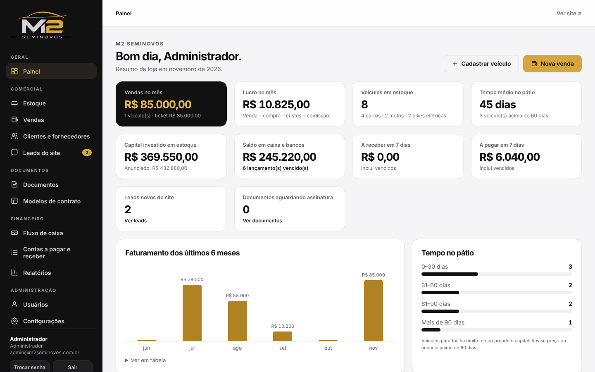

# M2 Seminovos — Sistema de gestão

Sistema web da **M2 Seminovos** (carros, motos e bikes elétricas seminovos), com site de apresentação, área restrita com login e gestão completa da loja. Visual baseado no design system **M2 Seminovos** (dourado `#d6a63d`, preto `#111111`, fonte Inter e logos oficiais).



## O que o sistema faz

| Módulo | Funções |
| --- | --- |
| **Site público** (`/`) | Vitrine do estoque publicado com filtros por categoria, busca e ordenação; página do veículo com galeria, ficha técnica, "Tenho interesse", botão de WhatsApp e "Venda seu veículo". Os contatos viram **leads** no sistema. |
| **Login / perfis** (`/login`) | Administrador, Gerente, Financeiro e Vendedor. O vendedor **não vê** valor de compra, custos nem margem. |
| **Estoque** | Cadastro de carro, moto ou bike elétrica; valor e forma de compra, fornecedor, preço anunciado e mínimo, situação (preparação, disponível, reservado, vendido), publicação no site, fotos (capa e galeria). **Dias no pátio** calculados automaticamente. |
| **Custos por veículo** | Mecânica, funilaria, documentação, pneus etc. Cada custo entra na margem do veículo e gera saída no fluxo de caixa (paga ou a pagar). |
| **FIPE** | Consulta em cascata (tipo → marca → modelo → ano) na API pública da FIPE, histórico de valores, % do preço sobre a FIPE, % da compra sobre a FIPE, botão "Atualizar FIPE do estoque". Valor manual para bikes elétricas. |
| **Vendas** | Venda com várias formas de pagamento (PIX, dinheiro, cartão, financiamento, boleto, cheque, **veículo na troca**), gerador de parcelas, comissão do vendedor, garantia, lucro previsto. A troca entra sozinha no estoque. Cancelamento devolve o veículo e cancela os lançamentos. |
| **Documentos** | Modelos editáveis (contrato de compra e venda, recibo de pagamento, recibo de compra, termo de garantia, termo de entrega) com campos automáticos `{{cliente.nome}}`, `{{venda.valor_extenso}}` etc. Gera **PDF** com a logo, envia por **e-mail** com o PDF anexo e cria **link de assinatura pelo WhatsApp**. |
| **Assinatura eletrônica** (`/assinar/…`) | O cliente abre o link no celular, lê o documento, informa nome e CPF e assina com o dedo. O PDF passa a ter a assinatura, data/hora, IP e hash SHA-256 do conteúdo. |
| **Fluxo de caixa** | Saldo por conta (caixa, bancos), entradas e saídas realizadas e previstas por dia, saldo previsto no fim do mês, contas a pagar e receber com baixa, estorno, despesas recorrentes (parcelas). |
| **Relatórios** | Vendas (lucro por veículo, por vendedor, por categoria), Financeiro (DRE simplificado + caixa por categoria) e Estoque (tempo no pátio, capital investido, % FIPE). Exporta **PDF** e **CSV** (Excel). |
| **Painel** | Vendas e lucro do mês, estoque, tempo médio no pátio, capital investido, saldo, contas da semana, gráfico de 6 meses, veículos parados há mais de 60 dias. |

## Como rodar

Requisitos: **Node.js 20 ou superior**.

```bash
npm install
```

```bash
npm start
```

Acesse `http://localhost:3000` (site) e `http://localhost:3000/login` (sistema).

Primeiro acesso: **admin@m2seminovos.com.br / m2admin123**. Troque a senha em *Trocar senha* (menu lateral). Para definir outro admin inicial, rode com `ADMIN_EMAIL` e `ADMIN_PASSWORD` na primeira execução.

### Dados de demonstração (opcional)

Para conhecer o sistema com veículos, vendas e lançamentos de exemplo (marcados como "demo"):

```bash
npm run seed:demo
```

Para voltar ao zero, apague a pasta `data/` e rode `npm start` de novo.

## Configuração depois de instalar

Em **Configurações**:

1. **Dados da empresa**: razão social, CNPJ, endereço, cidade, foro. Entram nos contratos, recibos e no rodapé do site.
2. **WhatsApp da loja**: usado nos botões do site.
3. **Endereço público do sistema** (ex.: `https://sistema.m2seminovos.com.br`): é a base dos links de assinatura enviados ao cliente.
4. **E-mail (SMTP)**: servidor, porta, usuário e senha. Exemplo Gmail: `smtp.gmail.com`, porta `465`, SSL "Sim", senha de app do Google. Use "Enviar e-mail de teste".

## Publicação (produção)

O sistema é um único processo Node com banco SQLite em `data/` (banco `m2.db` e fotos em `data/uploads`).

- **VPS / servidor próprio**: `npm install --omit=dev` e `npm start` com PM2 ou systemd, atrás de Nginx com HTTPS.
- **Docker**: `docker build -t m2-seminovos .` e `docker run -p 3000:3000 -v m2data:/app/data m2-seminovos`.
- **Render / Railway / Fly.io**: use um **disco persistente** montado em `/app/data` (ou defina `DATA_DIR`).

Variáveis: `PORT` (padrão 3000), `DATA_DIR` (padrão `./data`), `ADMIN_EMAIL`, `ADMIN_PASSWORD`, `FIPE_API` (padrão `https://parallelum.com.br/fipe/api/v1`).

**Backup:** copie a pasta `data/` (banco + fotos). Com o sistema rodando, prefira `sqlite3 data/m2.db ".backup backup.db"`.

**HTTPS é obrigatório em produção**: o login usa cookie de sessão e os links de assinatura circulam por WhatsApp.

## Observações importantes

- **Assinatura eletrônica**: é uma assinatura eletrônica *simples* (Lei 14.063/2020), com registro de nome, CPF, data/hora, IP e hash do documento. Para a transferência no DETRAN continua valendo a ATPV-e e o reconhecimento exigido pelo órgão. Revise os modelos de contrato com o seu advogado ou contador antes de usar.
- **FIPE**: a consulta usa a API pública e gratuita da Parallelum, que tem limite de requisições por dia. Se ela estiver fora do ar, informe o valor manualmente.
- **WhatsApp**: o botão abre o WhatsApp (Web ou app) com a mensagem e o link prontos; o envio é feito por você. Envio automático exige a API oficial do WhatsApp Business (paga), que pode ser integrada depois.

## Estrutura

```
src/        servidor (Express + SQLite): rotas, PDF, e-mail, modelos padrão
public/     site público (index.html, site/), sistema (app/), login, página de assinatura
public/assets/  tokens e componentes do design system M2 Seminovos, logos
scripts/    seed de demonstração
data/       banco e fotos (criado na primeira execução; não versionar)
```
